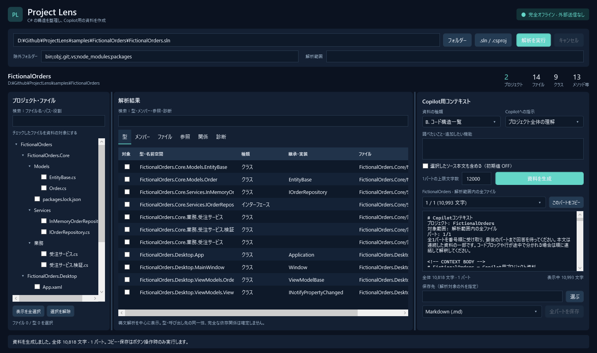
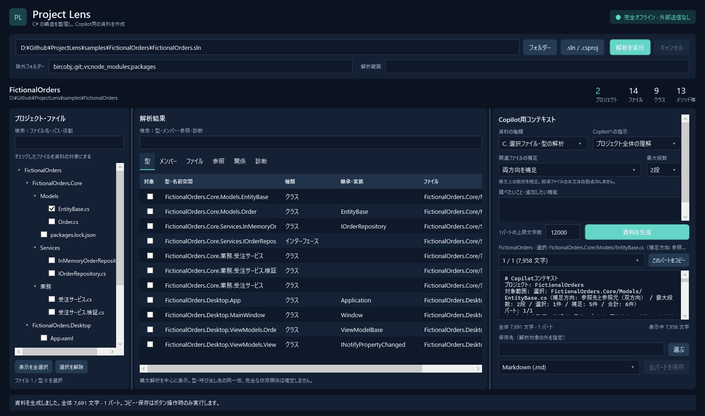

# ProjectLens ビルド・利用ガイド

C# プロジェクトを調べて、Copilot に渡す資料を作る

作成日: 2026年10月14日 / 対象ソース: `9b93a20`

## 1. ツールの概要

ProjectLens は、手元の C# プロジェクトを解析し、構成やコードの構造を説明する資料を作る Windows アプリです。既存システムの理解、機能追加の影響確認、不具合の調査などで、Microsoft 365 Copilot に渡す情報を整理できます。

### 作業の流れ

1. PC にある `.sln`、`.slnx`、`.csproj` またはフォルダーを選ぶ。
2. ProjectLens で解析し、必要な範囲の資料と依頼文を作る。
3. プレビューを確認してコピーするか、Markdown・テキストで保存する。
4. 利用者が Copilot に貼り付け、回答を元のコードと見比べる。

解析と資料作成は PC 内で完結します。対象プロジェクトをビルド・実行する必要はなく、元のソースを書き換える機能もありません。Copilot への送信は利用者が行います。

### 確認できる内容

| 調べたいこと | ProjectLens で確認するもの |
|---|---|
| どんな構成のシステムか | プロジェクト、フレームワーク、ファイル、参照宣言 |
| どこに何が書かれているか | 名前空間、型、メソッド、引数、戻り値、行番号 |
| 特定の機能に何が関係するか | 選択ファイル・型と、方向・段数を指定した構文上の関連 |

### 目的別の読み方

| 目的 | 読む章・PDF のページ |
|---|---|
| ソースからビルドして使う | 2〜3 → 4〜5 |
| 配布された ZIP を使う | 10 の「ZIP からの起動」→ 4〜5 |
| 実務で資料を作る | 6〜9 |
| 配布・オフライン利用を準備する | 10〜11 |
| エラーを解決する | 12 |

<!-- pagebreak -->

## 2. 開発環境の準備

ソースからビルドする方は、Windows 上に開発環境を用意してください。配布 ZIP を使うだけの方は、10章へ進めます。

### 必要なもの

| 項目 | 準備・確認する内容 |
|---|---|
| OS | 確認済み環境は Windows 11 / 64 ビット |
| .NET | .NET 10 SDK。ランタイムだけではビルドできません |
| Visual Studio を使う場合 | Visual Studio 2026 と「.NET デスクトップ開発」ワークロード |
| ソース一式 | `ProjectLens.sln`、`src`、`tests`、ロックファイル、設定ファイル |
| 初回のパッケージ復元 | NuGet.org に接続できる環境、または11章のオフラインキット |

CLI でビルドする場合も、.NET SDK と Windows Desktop の参照パックが必要です。Visual Studio の上記ワークロードで用意できます。Microsoft Office のインストールは不要です。

### SDK の確認

PowerShell で次を実行し、SDK が表示されることを確認してください。

```powershell
dotnet --info
```

この資料の確認時には SDK `10.0.400` を使用しました。`global.json` は `10.0.100` を基準に、インストール済みの安定版 .NET 10 SDK を選ぶ設定です。

### Visual Studio でのビルドと起動

1. `ProjectLens.sln` を開く。
2. ソリューション エクスプローラーで `ProjectLens.App` を右クリックし、スタートアッププロジェクトに設定する。
3. 構成を `Release` にする。
4. 「ビルド」からソリューションをビルドする。
5. 成功したら `F5` で起動する。

テストはコンソール形式です。Visual Studio でビルドした場合も、確認には3章のテストコマンドを使ってください。

<!-- pagebreak -->

## 3. PowerShell でのビルド

PowerShell を開き、`ProjectLens.sln` があるフォルダーへ移動してください。以下のパスは、この作業環境の例です。

```powershell
Set-Location 'D:\Github\ProjectLens'
```

### 復元・ビルド・テスト

次の3行を上から順に実行してください。各コマンドが成功してから次へ進みます。

```powershell
dotnet restore ProjectLens.sln --locked-mode
dotnet build ProjectLens.sln -c Release --no-restore
dotnet run --project tests/ProjectLens.Tests -c Release --no-build
```

| コマンド | 何をするか | 成功の目安 |
|---|---|---|
| `restore` | ロックファイルに沿って依存パッケージを用意する | 復元エラーが出ない |
| `build` | Release 構成で実行用ファイルを作る | 「ビルドに成功しました」 |
| Tests の `run` | 解析・生成・保存などのテストを実行する | 「結果: 13 / 13 成功」 |

テストは **`dotnet run` で実行**します。`dotnet test` を実行する構成ではありません。テストの終了コードは、成功時が0、失敗時が1です。

### アプリの起動

```powershell
dotnet run --project src/ProjectLens.App -c Release --no-build
```

通常起動では空の画面が開きます。解析対象を選んで「解析を実行」を押してください。

### コマンドの指定

`--no-restore` は、直前に用意したパッケージでビルドする指定です。`--no-build` は、作成済みの実行用ファイルを使う指定です。ソースを変更した後は、ビルドとテストをやり直してから起動してください。

通常のビルド結果は `src\ProjectLens.App\bin\Release\net10.0-windows\` に置かれます。他の PC に渡す場合は、10章の配布手順を使ってください。

<!-- pagebreak -->

## 4. 画面の見方

上で解析対象を指定し、左で対象ファイルを確認します。中央で解析結果を調べ、右で Copilot に渡す資料を作ります。



図は同梱サンプルの解析後の画面です。資料の種類は「B. コード構造一覧」にしています。通常起動時は、まだ解析結果やプレビューはありません。

| 場所 | 主な操作 |
|---|---|
| 上部 | 入力パス、除外フォルダー、解析範囲を指定。「解析を実行」で開始 |
| 左側 | ファイルを検索し、チェックボックスで資料の対象を選ぶ |
| 中央 | 「型」「メンバー」「ファイル」「参照」「関係」「診断」を確認 |
| 右側 | 資料の種類、依頼文、本文の有無、分割文字数を指定。生成・コピー・保存 |
| 下部 | 進捗、完了状態、エラーの説明を確認 |

### 中央のタブ

「型」はクラスなどの宣言、「メンバー」はメソッドやプロパティを表示します。「参照」はプロジェクトファイルの参照宣言、「関係」はファイル間の関係と根拠を確認する場所です。読み取りの問題や構文エラーは「診断」に表示されます。

「ファイル」タブで行を選ぶと、役割メモや名前空間を確認できます。役割メモを編集しても、対象のソースコードは変更されません。

<!-- pagebreak -->

## 5. サンプルで試す

ソース一式に含まれる `FictionalOrders` は、受注処理を題材にした架空の WPF プロジェクトです。ProjectLens 本体を起動できれば、サンプル自体をビルドしなくても解析できます。配布 ZIP にはサンプルが含まれないため、使う場合は `samples\FictionalOrders` を別途コピーしてください。

### 全体概要を作る

1. 「.sln / .csproj」を押し、次のファイルを選ぶ。このボタンから `.slnx` も選べます。

```text
D:\Github\ProjectLens\samples\FictionalOrders\FictionalOrders.sln
```

2. 「除外フォルダー」は初期値のまま、「解析範囲」は空欄にする。
3. 「解析を実行」を押す。完了後、「参照」タブで `FictionalOrders.Core` と `FictionalOrders.Desktop` を確認する。
4. 「資料の種類」を「A. プロジェクト全体概要」、「Copilotへの指示」を「プロジェクト全体の理解」にする。
5. 「調べたいこと・追加したい機能」に、次の依頼文を入力する。

> このアプリの構成と、受注登録に関係するクラスを説明してください。

6. ソース本文は OFF のまま「資料を生成」を押す。プレビューにプロジェクトの説明と依頼文が出れば、資料作成まで確認できています。

この資料の作成時は、2プロジェクト・14ファイルが表示されました。サンプルや設定を変更すると件数も変わります。

### 一つの機能を調べる

左側の検索欄に `OrdersViewModel` と入力し、該当ファイルのチェックボックスをオンにしてください。「C. 選択ファイル・型の解析」と「特定機能の解析」を選び、次の依頼文で資料を生成します。

> AddExample の入力、処理、関連クラスを説明してください。

処理の実装も含める場合は「選択したソース本文も含める」をオンにして再生成してください。コピーと保存の手順は8章にあります。

<!-- pagebreak -->

## 6. 解析対象と資料の範囲

### WebAPI を調べる

中央の「WebAPI」タブで「呼び出し・処理」と「接続設定」を確認できます。呼び出しを選ぶと送信データ、応答の型・読み込み、結果の利用やエラー処理の候補を根拠行付きで表示します。資料の対象へファイルを追加して C の資料を生成すると、その範囲の WebAPI 情報も含まれます。設定ファイルが必要な場合はそのファイルも選択してください。

これらは構文上の候補です。実行時の URL や設定と呼び出しの対応、別メソッド・画面までの完全な処理は確定しません。詳しい対応範囲と依頼文の例は [WebAPI 解析](WEBAPI-ANALYSIS.md) を参照してください。

### 入力の選び方

| 入力 | 解析するプロジェクト |
|---|---|
| `.sln` / `.slnx` | ソリューションに列挙されたプロジェクト |
| `.csproj` | 指定した一つのプロジェクト |
| フォルダー | そのフォルダー以下を再帰的に探索 |

入力にはローカルの絶対パスを使います。ネットワークパスや、リンク・ジャンクションを含むパスは使用できません。解析ルートは、フォルダーを指定した場合はそのフォルダー、ファイルを指定した場合はその親フォルダーです。

### 解析範囲と除外

「解析範囲」はルートからの相対パスを `;` で区切ります。空欄なら全体です。サンプルの `.sln` を入力した場合、Core の業務フォルダーだけを調べる指定は次のとおりです。

```text
FictionalOrders.Core\業務
```

「除外フォルダー」の初期値は次のとおりです。追加する場合は、末尾に `;` とフォルダー名を足してください。

```text
bin;obj;.git;.vs;node_modules;packages
```

入力パス、解析範囲、除外を変えた後は「解析を実行」を押し直してください。解析ルートの外にある参照先も調べたい場合は、必要なプロジェクトを含む共通の親フォルダーなどを入力にします。

### ファイル・型のチェック

チェックは「C. 選択ファイル・型の解析」の対象と、資料に含めるソース本文を指定するために使います。行を選ぶだけでは、資料の対象に入りません。

**A・B の構造情報は、解析範囲全体が対象**です。チェックを外しても範囲は縮まりません。構造情報を絞る場合は「解析範囲」を指定して再解析するか、C を使ってください。

検索は表示を絞る操作です。検索しただけでは資料の対象は変わりません。「表示を全選択」は左側の検索で表示されているファイルをチェックします。「選択を解除」はファイルと型の両方のチェックを外します。

<!-- pagebreak -->

## 7. 資料の種類と依頼文

### 資料の種類

| 画面の選択肢 | 含まれる内容 | 主な用途 |
|---|---|---|
| A. プロジェクト全体概要 | 構成、参照、役割、解析範囲の型宣言。メンバーの詳細表は省略 | 初めて読むプロジェクトの理解 |
| B. コード構造一覧 | 全体概要に加え、メンバー、引数、戻り値、修飾子、行番号 | 実装場所や宣言の確認 |
| C. 選択ファイル・型の解析 | 選択した定義ファイルと、指定方向・最大1〜3段で補足した関連ファイルの構造 | 特定の機能や変更箇所の調査 |

### 関連ファイルの補足

C を選ぶと、補足する方向と最大段数を設定できます。初期値は「両方向を補足」「1段」です。

| 選択肢 | 含まれるファイル | 使い方の例 |
|---|---|---|
| 選択したファイル・型のみ | チェックしたファイルと、チェックした型の定義ファイル | 対象を限定して資料を短くする |
| 参照先を補足 | 関係表の起点から関連先へたどったファイル | 処理が使う型や基底型を調べる |
| 参照元を補足 | 関係表の関連先から起点へ逆にたどったファイル | 変更する型を使う箇所の候補を調べる |
| 両方向を補足 | 参照先・参照元の両方をたどったファイル | 機能に関係する構造を広く確認する |

たとえば `画面.cs → 業務.cs → 契約.cs` という関係なら、`画面.cs` を選択して参照先を1段補足すると `業務.cs`、2段なら `契約.cs` も含まれます。`業務.cs` を選択して参照元を1段補足すると `画面.cs` が含まれます。選択のみでは段数を使いません。

プレビューの「選択範囲と関連ファイル」で、明示選択と補足、選択対象からの最短段数を確認してください。循環参照があっても同じファイルを重複追加せず、解析済みの範囲だけをたどります。型の選択で複数の定義ファイルが該当する場合は、それらすべてが出発点です。

これは構文上の関係で、変更の影響を確定する機能ではありません。XAML とコードビハインドの対応も関係表の方向に従います。C の関係表は両端が対象範囲にある関係だけを表示しますが、プロジェクト構成・参照宣言は全体情報として残ります。A・B の資料では関連補足の設定を使いません。



右側の設定欄は縦にスクロールできます。依頼文や本文のチェックが見えない場合は設定欄を下へスクロールしてください。「資料を生成」とプレビューは設定欄の外にあります。

### Copilot への指示

| 選択肢 | 依頼文に書く内容の例 |
|---|---|
| プロジェクト全体の理解 | 構成と各プロジェクトの役割を説明してほしい |
| 特定機能の解析 | 受注登録の入力から保存までの処理を知りたい |
| 既存機能の改善案 | 入力チェックの改善箇所を検討したい |
| 新機能の影響範囲 | 受注キャンセルを追加する場合の変更候補を知りたい |
| リファクタリング計画 | 対象クラスの責務を分ける手順を検討したい |
| 不具合の原因調査 | 再現条件と症状を示し、確認箇所を挙げてほしい |

「調べたいこと・追加したい機能」には、対象の機能名と知りたい内容を具体的に書いてください。不具合なら、症状・再現条件・期待する動作も記載します。

### ソース本文を含める場合

初期値は OFF です。ON にする場合は、資料の種類にかかわらずファイルまたは型のチェックが必要です。型をチェックすると、その型を定義するファイル全体の本文が入ります。C で補足された関連ファイルの本文は、自動では入りません。

資料の種類、関連補足の方向・段数、Copilot への指示、依頼文、本文の有無、分割文字数、対象のチェック、役割メモを変更すると、古いプレビューは無効になります。「資料を生成」を押し直してからコピー・保存してください。

<!-- pagebreak -->

## 8. Copilot への受け渡しと保存

### パートをコピーする

1. 「資料を生成」を押し、プレビューを読む。
2. パート選択欄で `1 / N` を選び、「このパートをコピー」を押す。
3. 利用者が Copilot の入力欄へ貼り付ける。
4. 複数パートの場合は、2、3と番号順に渡す。全パートを渡し終えてから回答を求める。

生成しただけではクリップボードは変更されません。コピーされるのは、画面で選んでいる一つのパートです。

### 分割文字数

「1パートの上限文字数」の初期値は `12000`、設定できる範囲は `1000〜100000` です。パートの見出しも含めて分割します。画面の数値は UTF-16 の文字数で、トークン数や Copilot の入力上限を表すものではありません。

貼り付け先が受け付ける量に合わせて文字数を調整し、再生成してください。コードブロックや行がパートの途中で分かれる場合があります。各パートに書かれた案内に従い、順番を保って渡します。

### 全パートを保存する

1. 「保存先」に解析ルートの外にあるローカルフォルダーを指定する。
2. `Markdown (.md)` または `テキスト (.txt)` を選ぶ。
3. 「全パートを保存」を押す。
4. 指定したフォルダーで、各パートのファイルを確認する。

保存先の例は `D:\ProjectLens-Output` です。絶対パスで指定してください。未作成のフォルダーは保存時に作成されます。ネットワークパスやリンク経由の保存先は使用できません。

```text
ProjectLens-プロジェクト名-日時-GUID-part-001-of-003.md
```

保存は UTF-8 で、1パートにつき1ファイルです。日時と GUID を含む名前を付け、既存ファイルを上書きしません。`.txt` でも資料本文は同じです。

### 受け渡し前の確認

本文を OFF にしても、型名、ファイルパス、役割などが資料に含まれます。プレビューを読み、社内の情報管理ルールに従って渡してください。コピーした内容は Windows のクリップボード履歴・同期の対象になる場合があります。

<!-- pagebreak -->

## 9. 解析結果の読み方と制約

### 構文から読み取る情報

C# の解析には Roslyn を使っています。Roslyn は C# のコードを構文として読み取るためのライブラリです。ProjectLens はクラス、インターフェース、record、継承・実装の記述、コンストラクター、メソッド、プロパティなどを抽出します。

partial の型は、各ファイルの宣言として一覧に現れます。画面上部の「クラス」は同一プロジェクトの同名 partial 型をまとめて数えるため、一覧の行数とは一致しない場合があります。

### 宣言と推定の違い

| 情報 | 結果の受け取り方 |
|---|---|
| ProjectReference | プロジェクトファイルに参照宣言があることを確認した情報 |
| 型利用・継承などのファイル間関係 | 構文上の手がかりによる推定。確度と根拠を確認する |
| XAML とコードビハインド | XAML の `x:Class` と C# 型名の一致による推定。バインディング全体の解析ではない |

同名の型、別名、外部ライブラリなどでは、関係を誤って推定したり見つけられなかったりする場合があります。完全な型解決や呼び出しグラフは作成しません。

### ビルド結果との違い

`.csproj` は XML の記述を直接読みます。MSBuild の条件、Import、変数展開、`Compile Include/Remove` などを完全には評価しません。そのため、実際のビルド対象外のファイルが含まれる場合があります。未指定のプリプロセッサシンボルで無効になる `#if` の宣言は、結果に現れない場合があります。

**診断がないことは、ビルド成功を意味しません**。変更の判断には元のコードを確認し、対象プロジェクトのビルドやテストも使ってください。

### ファイルの読み取り

探索する拡張子は `.cs`、`.xaml`、`.razor`、`.cshtml`、`.json`、`.config`、`.resx`、`.xml` です。C# を構文解析し、ほかは構成・参考情報として扱います。ASP.NET や Windows Forms 固有の DI、ルーティング、画面イベントなどの詳細解析は行いません。

1ファイルの読み取り上限は初期設定で4 MiBです。読み取れないファイルや構文エラーは「診断」で確認します。UTF-8 と BOM 付き Unicode に対応し、UTF-8 として読めない場合は CP932 を試します。

<!-- pagebreak -->

## 10. ZIP 配布と起動

### 配布物を作る

3章のビルドとテストが成功した開発 PC で、リポジトリーのルートから実行してください。初回は配布用のランタイムパックも復元するため、接続可能な環境を使います。

```powershell
.\scripts\Publish-Portable.ps1 -OutputDirectory C:\Tools\ProjectLens-win-x64
```

次のフォルダーと ZIP ができます。

```text
C:\Tools\ProjectLens-win-x64\
C:\Tools\ProjectLens-win-x64.zip
```

配布物は Release / win-x64 / self-contained です。self-contained は、実行に必要な .NET ランタイムを同梱する形式です。Roslyn と依存 DLL、ドキュメント、ライセンス通知も含みます。

既存の ZIP があると処理は止まります。作り直す場合は、新しい出力名を指定してください。出力フォルダーも新しい場所を使うと、古いファイルが残るのを避けられます。

### ZIP からの起動

1. ZIP 全体を、実行先 PC のローカルフォルダーへ展開する。
2. 展開したフォルダーの `ProjectLens.App.exe` を起動する。
3. 4章を参照し、手元の C# プロジェクトを選んで解析と資料生成を試す。

5章のサンプルを使う場合は、ソース一式の `samples\FictionalOrders` を別途コピーし、コピー先にある `.sln` を選んでください。配布 ZIP にサンプルは含まれません。

実行先には64ビット Windows が必要です。自己完結配布では .NET ランタイムの追加インストールは不要で、通常のユーザー権限で起動できます。

**EXE と同梱ファイルを一式で配布**してください。単一 EXE 化や trimming はしていません。DLL、ドキュメント、ライセンス通知を取り除かないでください。

### 更新と動作確認

同梱ランタイムを自動更新する機能はありません。更新時は開発環境で再ビルド・再検証し、新しい配布物を作成します。

配布する ZIP を起動し、別途用意したサンプルで解析、資料生成、コピー、保存を確認してください。オフラインで使う場合は、通信を遮断した状態でも確認します。詳しい確認手順は `docs/SECURITY-TESTS.md` にあります。

<!-- pagebreak -->

## 11. オフラインでのビルド

ProjectLens の実行時の処理と、ソースからのビルド準備は別です。オフライン PC でビルドする場合は、SDK・参照パックと依存パッケージを先に用意してください。

### 接続可能な PC での準備

リポジトリーのルートで、次を実行します。

```powershell
.\scripts\Prepare-Offline.ps1 -Destination C:\Tools\ProjectLensOfflineKit
```

キットには、Roslyn とその依存パッケージに加え、win-x64 の自己完結配布用ランタイムパックが入ります。`feed`、`NuGet.Offline.Config`、`SHA256.csv` と、確認用の `*.runtime.lock.json` を配置関係を保って移してください。`package-cache` は通常、コピー不要です。

### オフライン PC での復元とビルド

ソース一式とキットをコピーし、.NET 10 SDK と Windows Desktop の参照パックを用意します。次は、キットを `D:\Tools\ProjectLensOfflineKit` に置いた例です。ソースのルートで実行してください。

```powershell
dotnet restore ProjectLens.sln --locked-mode `
  --configfile D:\Tools\ProjectLensOfflineKit\NuGet.Offline.Config
dotnet build ProjectLens.sln -c Release --no-restore
dotnet run --project tests/ProjectLens.Tests -c Release --no-build
dotnet run --project src/ProjectLens.App -c Release --no-build
```

PowerShell の行末のバッククォートは、コマンドが次の行へ続く指定です。行末に空白を追加しないでください。

### オフラインで配布物を作る場合

```powershell
.\scripts\Publish-Portable.ps1 `
  -OutputDirectory C:\Tools\ProjectLens-win-x64 `
  -OfflineConfig D:\Tools\ProjectLensOfflineKit\NuGet.Offline.Config
```

`--configfile` は、その CLI コマンドだけに適用されます。Visual Studio でオフラインビルドする場合は、チェックアウト内の `NuGet.Config` を退避してからローカルフィード用に変更してください。設定例と不足パッケージの確認方法は `docs/OFFLINE.md` にあります。キットは SDK や Visual Studio の代わりにはなりません。

<!-- pagebreak -->

## 12. 困ったときの確認

| 症状 | 確認・対処 |
|---|---|
| `dotnet` が見つからない / SDK が合わない | .NET 10 SDK のインストールと `dotnet --info` を確認する |
| パッケージを復元できない | 通常は NuGet.org への接続、オフラインではキットの配置と不足 `.nupkg` を確認する |
| 「資料を生成」が押せない | 未解析、処理中、または解析条件を変更した状態。完了を待つか再解析する |
| C の生成や本文 ON で選択を求められる | ファイルか型のチェックを入れる。行の選択だけでは対象にならない |
| 設定変更後にプレビューが消えた | 「資料を生成」を押し直す。古い資料の誤使用を防ぐ動作 |
| 保存先を拒否される | 解析ルート外のローカル絶対パスを使う。ネットワークやリンク経由を避ける |
| 一部ファイルや参照先が出ない | 「診断」、解析範囲、除外、ルート外の参照、読み取り上限を確認する |
| 見出しが長すぎる / 貼り付けきれない | 前者は分割文字数を増やすか対象を減らす。後者は文字数を減らして再生成する |

### この資料で確認した範囲

2026年10月14日、Windows / win-x64、.NET SDK `10.0.400` で、依存パッケージの復元、Release ビルド、20項目のテスト成功を確認しました。ビルドの警告・エラーはともに0件でした。

開発用の WPF 起動検証で、画面初期化、サンプル解析、資料生成、関連条件を変更した後のプレビュー・コピー・保存の無効化と再生成、最小ウィンドウサイズの表示領域、画面画像の保存も確認しました。手動のクリップボード操作、今回の配布 ZIP 作成、通信遮断状態での実機確認は、この資料作成時には実施していません。

### 詳細資料と実装の参照先

| ファイル | 内容 |
|---|---|
| [README.md](../README.md) | 全体の説明と基本手順 |
| [docs/OFFLINE.md](OFFLINE.md) | オフラインキットと Visual Studio の設定例 |
| [docs/SECURITY-TESTS.md](SECURITY-TESTS.md) | UI、コピー、保存、通信遮断時の確認手順 |
| [docs/ARCHITECTURE.md](ARCHITECTURE.md) | 解析・資料生成・画面の構成 |
| [src/ProjectLens.App](../src/ProjectLens.App) | 画面、選択肢、操作と状態の実装 |
| [src/ProjectLens.Core](../src/ProjectLens.Core) | 解析、資料の生成、保存の実装 |

本資料は上記の実装と既存ドキュメントをもとに作成しました。画面や仕様を変更した場合は、該当する操作説明も更新してください。
